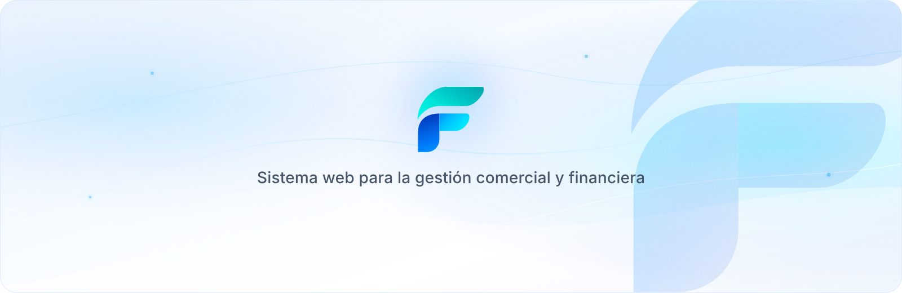

<p align="center">
  
</p>

<h1 align="center">Finora</h1>

<p align="center">
  <strong>Gestión comercial y financiera para emprendimientos de venta por catálogo</strong>
</p>

<p align="center">
  Plataforma web centralizada para productos, inventario, compras, pedidos, ventas al contado y crédito, cobranzas, reportes y catálogo público.
</p>

<p align="center">
  
  
  
  
  
  
</p>

---

## Sobre el proyecto

**Finora** es un sistema de información web concebido y desarrollado para optimizar la gestión comercial, operativa y financiera de emprendimientos de venta por catálogo.

El caso de estudio principal toma como referencia el modelo operativo de una consultora independiente de **Natura**, estructurado de forma flexible para adaptarse a cualquier modelo de venta directa, distribución por catálogo y comercialización minorista.

El sistema resuelve la dispersión operativa reemplazando anotaciones en papel, chats de WhatsApp desorganizados y hojas de cálculo manuales por una solución integral que conecta el catálogo de cara al cliente con un panel de control administrativo y financiero.

> **Título académico:** *Sistema de Información Web para la Gestión Comercial y Financiera de un Emprendimiento de Venta por Catálogo.*  
> **Nota:** Finora es un proyecto académico e independiente. No mantiene afiliación oficial con Natura ni con otras marcas comerciales utilizadas como caso de estudio.

---

## Actores del sistema y Roles de acceso

El sistema implementa un control de acceso basado en roles con middlewares dedicados (`rol.consultor`, `rol.operativo`, `rol.cliente`):

| Rol | Middleware | Responsabilidad y alcance en el sistema |
| :--- | :--- | :--- |
| **Consultor (`CONSULTOR`)** | `rol.consultor` | **Propietario / Asesor principal del emprendimiento.** Posee acceso global: panel de control ejecutivo, reportes financieros y comerciales con exportación, configuración del tipo de cambio (Bs / USD con integración al BCB), auditoría del sistema y administración exclusiva de usuarios. |
| **Colaborador (`COLABORADOR`)** | `rol.operativo` | **Asistente operativo.** Acceso al panel operativo para la gestión diaria: catálogo de productos, categorías, líneas, proveedores, clientes, recepción de compras/abastecimiento, control de inventario (kardex y ajustes), pedidos (reserva y entrega), ventas y registro de pagos. No accede a reportes financieros confidenciales ni a la administración de usuarios. |
| **Cliente (`CLIENTE`)** | `rol.cliente` | **Comprador final.** Acceso a la landing page pública, catálogo interactivo con conversión de moneda, carrito para solicitar pedidos y portal privado (*Mi Cuenta*) para consultar su historial de compras y el saldo de sus créditos. |

---

## Módulos y Funcionalidades del Sistema

### 1. Catálogo Público y Pedidos de Clientes
* **Landing informativa y Catálogo:** Exploración de productos organizados por líneas y categorías con filtros dinámicos.
* **Carrito de pedidos:** Selección de artículos con cálculo de totales en Bolivianos (Bs) y Dólares (USD).
* **Solicitud de pedido:** Envío de órdenes públicas con datos de entrega y enlace directo para confirmación vía WhatsApp.
* **Portal de Cliente (`/mi-cuenta`):** Consulta histórica de pedidos realizados, estado de despacho y seguimiento de deudas/créditos pendientes.

### 2. Comercialización y Ventas
* **Flujo integral de pedidos:** Recepción, reserva automática de existencias, entrega de mercadería y cambio de estado.
* **Ventas al contado y a crédito:** Registro detallado con emisión de comprobantes, selección de forma de pago y cálculo de saldo.
* **Gestión de créditos y cuotas:** Seguimiento de créditos otorgados a clientes, planes de pago en cuotas y registro de amortizaciones/pagos.
* **Anulación y confirmación:** Control transaccional con reversión de inventario y saldos ante anulaciones.

### 3. Abastecimiento e Inventario
* **Gestión de proveedores y compras:** Registro de compras con detalle por producto, precio de costo y cálculo de márgenes.
* **Inventario en tiempo real:** Control de existencias físicas disponibles vs. reservadas para pedidos.
* **Kardex de movimientos:** Trazabilidad completa de ingresos (compras), salidas (ventas) y ajustes.
* **Ajustes manuales de inventario:** Regularización justificada por pérdidas, mermas o inventario físico.

### 4. Finanzas y Tipo de Cambio
* **Tipo de cambio dinámico:** Consulta automatizada del tipo de cambio oficial ante el Banco Central de Bolivia (BCB) con tasa de contingencia (*fallback*) y posibilidad de ajuste manual por parte del Consultor.
* **Gestión de cobranzas:** Registro de pagos aplicados directamente a cuotas específicas o al saldo general de créditos.

### 5. Administración, Auditoría y Reportes
* **Reportes gerenciales:** Análisis de ventas por período, productos más vendidos, compras realizadas, estado de créditos por cobrar y márgenes de ganancia.
* **Exportación de datos:** Descarga de reportes en formatos estándar para análisis externo.
* **Gestión de usuarios:** Registro, edición y activación/desactivación de cuentas con roles diferenciados.
* **Auditoría de operaciones:** Registro de actividad clave para trazabilidad de transacciones críticas.

---

## Mapa de Rutas Principales

```text
├── Públicas
│   ├── GET  /                    -> Landing page pública
│   ├── GET  /categorias          -> Catálogo de productos interactivo
│   ├── GET  /carrito             -> Carrito y formulario de pedido público
│   ├── POST /carrito/pedido      -> Envío de pedido público
│   ├── GET  /tipo-cambio         -> Consulta pública del tipo de cambio
│   ├── GET  /login               -> Formulario de inicio de sesión
│   └── POST /logout              -> Cierre de sesión seguro
│
├── Cliente (rol.cliente)
│   └── GET  /mi-cuenta           -> Portal de autoservicio del cliente
│
├── Panel Operativo (rol.operativo: CONSULTOR y COLABORADOR)
│   ├── GET   /panel/colaborador  -> Dashboard operativo
│   ├── CRUD  /panel/productos    -> Catálogo, edición y toggle de estado
│   ├── CRUD  /panel/categorias   -> Categorías de productos
│   ├── CRUD  /panel/lineas       -> Líneas de marca
│   ├── CRUD  /panel/proveedores  -> Directorio de proveedores
│   ├── CRUD  /panel/clientes     -> Clientes, historial y habilitación de accesos
│   ├── CRUD  /panel/compras      -> Abastecimiento y detalle de compras
│   ├── GET   /panel/inventario   -> Monitor de stock
│   │   ├── GET  /movimientos     -> Kardex histórico
│   │   └── POST /ajuste          -> Ajustes de stock
│   ├── CRUD  /panel/pedidos      -> Gestión, reserva y entrega de pedidos
│   ├── CRUD  /panel/ventas       -> Ventas al contado y crédito
│   └── CRUD  /panel/pagos        -> Registro de cobranzas y cuotas
│
└── Panel Exclusivo Consultor (rol.consultor)
    ├── GET   /panel              -> Dashboard ejecutivo y analítica
    ├── GET   /panel/reportes     -> Reportes comerciales y financieros
    │   └── GET  /exportar        -> Exportación de datos
    ├── PATCH /panel/tipo-cambio  -> Actualización del tipo de cambio
    └── CRUD  /panel/usuarios     -> Administración de accesos del sistema
```

---

## Cuentas de Demostración

El seeder inicial genera usuarios listos para pruebas en cada uno de los roles:

| Rol | Correo electrónico | Contraseña predeterminada | Panel al que accede |
| :--- | :--- | :--- | :--- |
| **Consultor** | `consultora.demo@finora.test` | `FinoraDemo2026!` | `/panel` (Acceso total) |
| **Colaborador** | `colaborador.demo@finora.test` | `FinoraDemo2026!` | `/panel/colaborador` (Operativo) |
| **Cliente** | `ana.cliente@finora.test` | `FinoraDemo2026!` | `/mi-cuenta` (Portal Cliente) |

---

## Tecnologías Utilizadas

| Componente | Tecnología | Propósito |
| :--- | :--- | :--- |
| **Backend** | **Laravel 13** / **PHP 8.5.12+** | Framework robusto bajo arquitectura MVC, routing, middlewares y Eloquent ORM. |
| **Base de datos** | **MySQL 8.0+** | Almacenamiento relacional, integridad referencial y transacciones ACID. |
| **Frontend** | **Blade Templates** | Renderizado del lado del servidor rápido y modular. |
| **Estilos** | **Tailwind CSS v4** | Diseño responsivo moderno con `@tailwindcss/vite`. |
| **Build Tool** | **Vite** | Empaquetado optimizado de assets en caliente (HMR). |
| **Integraciones** | **API BCB** | Consulta automatizada del tipo de cambio oficial de Bolivia. |
| **Metodología** | **Scrum** | Sprints, gestión de historias de usuario y desarrollo iterativo. |
| **Control de versiones** | **Git & GitHub** | Control de código fuente y flujo colaborativo de ramas. |

---

## Arquitectura del Proyecto

```text
finora/
├── app/
│   ├── Http/
│   │   ├── Controllers/
│   │   │   ├── Admin/          # Controladores operativos y administrativos
│   │   │   ├── Auth/           # Login y autenticación
│   │   │   ├── CatalogoController.php
│   │   │   ├── PanelController.php
│   │   │   └── ReporteController.php
│   │   ├── Middleware/         # Control por roles (Consultor, Operativo, Cliente)
│   │   └── Requests/           # Validaciones de formularios (FormRequests)
│   └── Models/                 # Modelos Eloquent y relaciones relacionales
├── config/
│   └── finora.php              # Configuración de moneda, BCB y cuentas demo
├── database/
│   ├── migrations/             # Esquema completo de la base de datos (29 migraciones)
│   └── seeders/                # Datos de prueba para catálogo y usuarios
├── resources/
│   ├── views/                  # Vistas Blade (landing, catálogo, cliente y panel)
│   └── css/                    # Estilos con Tailwind CSS v4
├── routes/
│   └── web.php                 # Definición de rutas y protecciones de acceso
└── tests/                      # Suite de pruebas automatizadas
```

---

## Requisitos del Entorno y Seguridad (Hardening)

Para garantizar la integridad del sistema en entornos de desarrollo y producción, se requiere:

* **PHP >= 8.5.12** *(Requisito estricto de seguridad: mitiga las vulnerabilidades críticas de corrupción de memoria y RCE **CVE-2026-109618** y **CVE-2026-109619** / PHP2Shell presentes en versiones `<= 8.5.11`)*.
* **Composer 2.x** y **Node.js (LTS)**.
* **MySQL 8.0** o superior.
* **Git**.

### Auditoría continua de dependencias (SCA)
El árbol de dependencias (`composer.lock` y `package-lock.json`) se encuentra auditado y libre de vulnerabilidades conocidas (incluyendo **CVE-2026-108082** en `symfony/http-foundation`). Para verificar el estado de seguridad antes de desplegar, ejecute:

```bash
composer audit
npm audit
```

---

## Puesta en Marcha Local

### Método Rápido Automatizado (Recomendado)

El proyecto incluye un script de configuración integral que instala dependencias, crea el archivo `.env`, genera la clave de cifrado, crea la base de datos `finoradb` en MySQL si no existe, ejecuta las migraciones con todos los datos demo iniciales, vincula el almacenamiento de imágenes y compila los assets frontend:

```bash
# 1. Clonar el repositorio
git clone https://github.com/chacaejosue/finora.git
cd finora

# 2. Configurar entorno y base de datos (copia .env.example)
# Nota: Si tu MySQL requiere contraseña de root, crea o edita tu .env antes de continuar:
# DB_PASSWORD=tu_contraseña

# 3. Ejecutar la puesta en marcha completa automatizada
composer run setup

# 4. Iniciar el entorno de desarrollo
composer run dev
```

La aplicación estará lista y disponible en:
```text
http://localhost:8000
```

---

### Método Manual Paso a Paso

Si prefieres ejecutar cada comando de forma individual:

```bash
# 1. Clonar el repositorio
git clone https://github.com/chacaejosue/finora.git
cd finora

# 2. Instalar dependencias del backend
composer install

# 3. Configurar variables de entorno
copy .env.example .env    # En Windows
# cp .env.example .env    # En Linux / macOS

# 4. Generar la clave de aplicación
php artisan key:generate

# 5. Crear la base de datos MySQL (opcional: el comando lo hace por ti)
php artisan db:create
# O manualmente en MySQL: CREATE DATABASE finoradb CHARACTER SET utf8mb4 COLLATE utf8mb4_unicode_ci;

# 6. Ejecutar migraciones con datos demostrativos
php artisan migrate:fresh --seed

# 7. Crear el enlace simbólico para imágenes de productos
php artisan storage:link

# 8. Instalar dependencias de frontend y compilar
npm install
npm run build

# 9. Iniciar servidores de desarrollo
composer run dev
```

---

## Flujo de Trabajo

El desarrollo se organiza mediante **Scrum** y ramas de trabajo independientes creadas a partir de `main`:

```bash
git checkout main
git pull origin main
git switch -c feature/huXX-descripcion
```

---

## Licencia y Créditos

Proyecto desarrollado con fines académicos y de apoyo a emprendimientos comerciales independientes.

<p align="center">
  <strong>Finora</strong> &mdash; Sistema de Información Web para la Gestión Comercial y Financiera<br>
  Desarrollado con Laravel 13, PHP 8.5.12+, MySQL y Tailwind CSS.
</p>
