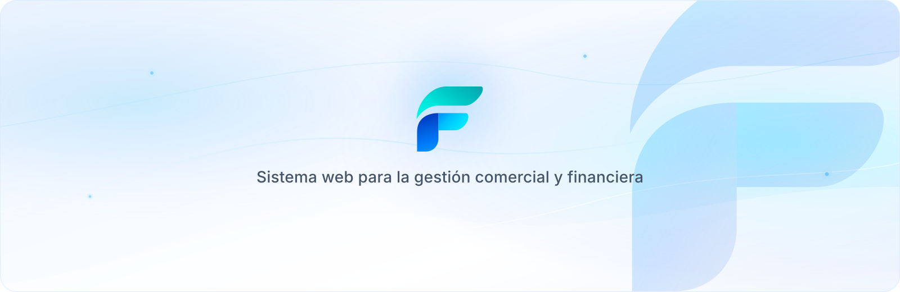

<p align="center">
  
</p>

<h1 align="center">Finora</h1>

<p align="center">
  <strong>Gestión comercial y financiera para emprendimientos de venta por catálogo</strong>
</p>

<p align="center">
  Plataforma web centralizada para productos, inventario, compras, pedidos, ventas al contado y crédito, cobranzas, reportes y catálogo público.
</p>

<p align="center">
  
  
  
  
  
  
</p>

---

## Sobre el proyecto

**Finora** es una solución web integral y ligera de gestión comercial, operativa y contable (ERP especializado) orientada a consultores independientes y emprendimientos de venta por catálogo y comercio directo.

El caso de estudio principal toma como referencia el modelo operativo de una consultora independiente de **Natura Cosméticos** en Bolivia, estructurado con una arquitectura modular y flexible para adaptarse a cualquier modelo de venta directa, distribución minorista y comercialización por comisiones.

El sistema resuelve integralmente la dispersión operativa reemplazando anotaciones en papel, chats desorganizados de WhatsApp y hojas de cálculo manuales por una plataforma moderna y unificada:
1. **Hacia el cliente:** Ofrece un catálogo digital interactivo, un sistema comunitario de recomendaciones (*likes* con corazones), promociones de ciclo y una bolsa de compras moderna tipo *luxury checkout* con formulario minimalista y confirmación directa por WhatsApp o en línea.
2. **Hacia la consultora (Trastienda):** Administra el inventario en tiempo real con kardex físico, el abastecimiento de compras, ventas al contado y planes de crédito en cuotas, cobranzas con cálculo del tipo de cambio oficial del BCB y contabilidad formal por partida doble.

> **Título académico:** *Sistema de Información Web para la Gestión Comercial y Financiera de un Emprendimiento de Venta por Catálogo.*  
> **Nota:** Finora es un proyecto académico e independiente. No mantiene afiliación oficial con Natura Cosméticos ni con otras marcas comerciales utilizadas como caso de estudio.

---

## Actores del sistema y Roles de acceso

El sistema implementa un control de acceso basado en roles con middlewares dedicados (`rol.consultor`, `rol.operativo`, `rol.cliente`):

| Rol | Middleware | Responsabilidad y alcance en el sistema |
| :--- | :--- | :--- |
| **Consultor (`CONSULTOR`)** | `rol.consultor` | **Propietario / Asesor principal del emprendimiento.** Posee acceso global: panel de control ejecutivo, reportes financieros y comerciales con exportación, configuración del tipo de cambio (Bs / USD con integración al BCB), módulo contable de partida doble, auditoría del sistema y administración exclusiva de usuarios. |
| **Colaborador (`COLABORADOR`)** | `rol.operativo` | **Asistente operativo.** Acceso al panel operativo para la gestión diaria: catálogo de productos, categorías, proveedores, clientes, recepción de compras/abastecimiento, control de inventario (kardex y ajustes), pedidos (reserva y entrega), ventas y registro de pagos. No accede a reportes financieros confidenciales ni a la administración de usuarios. |
| **Cliente (`CLIENTE`)** | `rol.cliente` | **Comprador final.** Acceso a la landing page pública, catálogo interactivo con conversión de moneda, sistema de me gusta (corazones), bolsa de compras para solicitar pedidos y portal privado (*Mi Cuenta*) para consultar su historial de pedidos y saldo de créditos. |

---

## Módulos y Funcionalidades del Sistema

### 1. Catálogo Público, Comunidad y Experiencia de Compra (UX/UI)
* **Landing Interactiva y Catálogo Moderno:** Navegación por categorías con pastillas de filtro simétricas (`h-9`), buscador dinámico reactivo en tiempo real y acceso directo a ofertas de ciclo.
* **Sistema Comunitario de Me Gusta (Corazones):** Interacción reactiva donde los clientes votan sus productos favoritos con persistencia en base de datos y localStorage. Los productos más votados se destacan automáticamente en la portada (*Lo más gustado de Natura*), complementados al azar con el catálogo disponible.
* **Experiencia Mobile-First Optimizada:** Carrusel táctil deslizante (*swipeable*) en celular para artículos destacados, jerarquía visual directa (texto hero, CTAs, fotografía y franja de confianza), sección sintética de suscripción a la revista Natura y pie de página ultracompacto para evitar deslizamientos largos.
* **Bolsa de Compras Rediseñada (`/carrito`):** Interfaz luxury de 2 columnas con formulario de entrega directo y minimalista, cálculo multimoneda (Bs y USD), eliminación total de emojis y sustitución por iconos SVG limpios.
* **Acceso Ergonómico en Móviles:** Navbar superior libre de redundancias y barra flotante táctil inferior con acceso directo a *Inicio*, *Catálogo*, *Mi Pedido* (con contador interactivo) y *WhatsApp*.
* **Portal de Autoservicio (`/mi-cuenta`):** Consulta histórica de pedidos, comprobantes, estado de despacho y seguimiento de cuotas/créditos pendientes.

### 2. Comercialización, Pedidos y Ventas
* **Flujo integral de pedidos:** Recepción, reserva automática de existencias físicas, entrega de mercadería y cambio de estado.
* **Ventas al contado y a crédito:** Registro con emisión de comprobantes, selección de forma de pago y cálculo automático de saldos.
* **Gestión de créditos y cuotas:** Seguimiento de créditos otorgados a clientes, cálculo de planes de pago en cuotas y registro de amortizaciones/pagos.
* **Integridad transaccional:** Control de anulaciones con reversión automática de inventario y saldos.

### 3. Abastecimiento y Control de Inventario
* **Gestión de proveedores y compras:** Registro de compras con detalle por producto, precio de costo y cálculo de márgenes comerciales.
* **Inventario en tiempo real:** Control de existencias físicas disponibles vs. reservadas para pedidos.
* **Kardex de movimientos:** Trazabilidad completa de ingresos (compras), salidas (ventas) y ajustes de stock.
* **Ajustes justificados de inventario:** Regularización documentada por mermas, pérdidas o inventario físico.

### 4. Finanzas, Cobranzas y Tipo de Cambio
* **Tipo de cambio dinámico:** Consulta automatizada del tipo de cambio oficial ante el Banco Central de Bolivia (BCB) con tasa de contingencia (*fallback*) y posibilidad de ajuste manual por parte del Consultor.
* **Gestión de cobranzas:** Registro de pagos aplicados directamente a cuotas específicas o al saldo general de créditos.

### 5. Contabilidad General por Partida Doble
* **Plan de Cuentas (`cuentas_contables`):** Estructura jerárquica de cuentas contables categorizadas en Activo, Pasivo, Patrimonio, Ingresos y Egresos.
* **Libro Diario y Asientos Contables (`asientos`, `detalles_asiento`):** Registro de transacciones con validación estricta de balance de partida doble (total Debe = total Haber) y glosas explicativas.
* **Integración Operativa:** Generación de asientos automáticos a partir de compras, ventas y recaudaciones de caja.

### 6. Administración, Auditoría y Reportes
* **Reportes gerenciales:** Análisis de ventas por período, productos más vendidos, compras realizadas, estado de créditos por cobrar y márgenes de ganancia.
* **Exportación de datos:** Descarga de reportes en formatos estándar para análisis externo.
* **Gestión de usuarios:** Registro, edición y activación/desactivación de cuentas con roles diferenciados.
* **Auditoría de operaciones:** Trazabilidad de operaciones críticas del sistema.

---

## Modelo de Base de Datos y Entidades Consolidadas

El esquema de base de datos se encuentra completamente consolidado en sus migraciones maestras, organizando 16 entidades relacionales clave:

| Módulo | Tablas | Descripción y Propósito |
| :--- | :--- | :--- |
| **Catálogo & Productos** | `categorias`, `productos` | Categorías de productos, catálogo general con precios de venta, costos, ofertas de ciclo y contador comunitario de `likes`. |
| **Ventas & Pedidos** | `pedidos`, `detalle_pedidos`, `ventas`, `detalle_ventas` | Pedidos públicos con datos de entrega/delivery, emisión de ventas al contado y crédito, detalle de ítems y métodos de pago. |
| **Créditos & Cobranzas** | `cuotas`, `pagos` | Fechas de vencimiento y saldos de créditos otorgados, con registro de cobros y pagos parciales. |
| **Abastecimiento & Stock** | `proveedores`, `compras`, `detalle_compras`, `movimientos_inventario` | Proveedores registrados, compras de mercadería y kardex histórico de movimientos de inventario (entradas, salidas y ajustes). |
| **Contabilidad General** | `cuentas_contables`, `asientos`, `detalles_asiento` | Plan contable estructurado y asientos del libro diario con débitos y créditos bajo el principio de partida doble. |
| **Seguridad & Acceso** | `usuarios`, `cache`, `sessions` | Cuentas de usuario con roles (`CONSULTOR`, `COLABORADOR`, `CLIENTE`), gestión de sesiones seguras y caché del sistema. |

---

## Mapa de Rutas Principales

```text
├── Públicas
│   ├── GET  /                    -> Landing page pública
│   ├── GET  /categorias          -> Catálogo de productos interactivo
│   ├── GET  /ofertas             -> Catálogo filtrado por promociones de ciclo
│   ├── POST /productos/{id}/like -> Votación reactiva comunitaria de 'Me Gusta'
│   ├── GET  /carrito             -> Bolsa de compras y checkout directo
│   ├── POST /carrito/pedido      -> Envío de pedido público
│   ├── GET  /tipo-cambio         -> Consulta pública del tipo de cambio
│   ├── GET  /login               -> Formulario de inicio de sesión
│   └── POST /logout              -> Cierre de sesión seguro
│
├── Cliente (rol.cliente)
│   └── GET  /mi-cuenta           -> Portal de autoservicio del cliente
│
├── Panel Operativo (rol.operativo: CONSULTOR y COLABORADOR)
│   ├── GET   /panel/colaborador  -> Dashboard operativo
│   ├── CRUD  /panel/productos    -> Catálogo, edición y toggle de estado
│   ├── CRUD  /panel/categorias   -> Categorías de productos
│   ├── CRUD  /panel/lineas       -> Líneas de marca
│   ├── CRUD  /panel/proveedores  -> Directorio de proveedores
│   ├── CRUD  /panel/clientes     -> Clientes, historial y habilitación de accesos
│   ├── CRUD  /panel/compras      -> Abastecimiento y detalle de compras
│   ├── GET   /panel/inventario   -> Monitor de stock
│   │   ├── GET  /movimientos     -> Kardex histórico
│   │   └── POST /ajuste          -> Ajustes de stock
│   ├── CRUD  /panel/pedidos      -> Gestión, reserva y entrega de pedidos
│   ├── CRUD  /panel/ventas       -> Ventas al contado y crédito
│   └── CRUD  /panel/pagos        -> Registro de cobranzas y cuotas
│
└── Panel Exclusivo Consultor (rol.consultor)
    ├── GET   /panel              -> Dashboard ejecutivo y analítica
    ├── GET   /panel/reportes     -> Reportes comerciales y financieros
    │   └── GET  /exportar        -> Exportación de datos
    ├── PATCH /panel/tipo-cambio  -> Actualización del tipo de cambio
    └── CRUD  /panel/usuarios     -> Administración de accesos del sistema
```

---

## Cuentas de Demostración

El seeder inicial genera usuarios listos para pruebas en cada uno de los roles:

| Rol | Correo electrónico | Contraseña predeterminada | Panel al que accede |
| :--- | :--- | :--- | :--- |
| **Consultor** | `consultora.demo@finora.test` | `FinoraDemo2026!` | `/panel` (Acceso total) |
| **Colaborador** | `colaborador.demo@finora.test` | `FinoraDemo2026!` | `/panel/colaborador` (Operativo) |
| **Cliente** | `ana.cliente@finora.test` | `FinoraDemo2026!` | `/mi-cuenta` (Portal Cliente) |

---

## Tecnologías Utilizadas

| Componente | Tecnología | Propósito |
| :--- | :--- | :--- |
| **Backend** | **Laravel 13** / **PHP 8.5.12+** | Framework robusto bajo arquitectura MVC, routing, middlewares y Eloquent ORM. |
| **Base de datos** | **MySQL 8.0+** | Almacenamiento relacional, integridad referencial y transacciones ACID. |
| **Frontend** | **Blade Templates** | Renderizado del lado del servidor rápido y modular. |
| **Estilos** | **Tailwind CSS v4** | Diseño responsivo moderno con `@tailwindcss/vite`. |
| **Build Tool** | **Vite** | Empaquetado optimizado de assets en caliente (HMR). |
| **Integraciones** | **API BCB** | Consulta automatizada del tipo de cambio oficial de Bolivia. |
| **Metodología** | **Scrum** | Sprints, gestión de historias de usuario y desarrollo iterativo. |
| **Control de versiones** | **Git & GitHub** | Control de código fuente y flujo colaborativo de ramas. |

---

## Arquitectura del Proyecto

```text
finora/
├── app/
│   ├── Http/
│   │   ├── Controllers/
│   │   │   ├── Admin/          # Controladores operativos y administrativos
│   │   │   ├── Auth/           # Login y autenticación
│   │   │   ├── CatalogoController.php
│   │   │   ├── PanelController.php
│   │   │   └── ReporteController.php
│   │   ├── Middleware/         # Control por roles (Consultor, Operativo, Cliente)
│   │   └── Requests/           # Validaciones de formularios (FormRequests)
│   └── Models/                 # Modelos Eloquent y relaciones relacionales
├── config/
│   └── finora.php              # Configuración de moneda, BCB y cuentas demo
├── database/
│   ├── migrations/             # Esquema consolidado de la base de datos (18 migraciones)
│   └── seeders/                # Datos de prueba para catálogo y usuarios
├── resources/
│   ├── views/                  # Vistas Blade (landing, catálogo, cliente y panel)
│   └── css/                    # Estilos con Tailwind CSS v4
├── routes/
│   └── web.php                 # Definición de rutas y protecciones de acceso
└── tests/                      # Suite de pruebas automatizadas
```

---

## Requisitos del Entorno y Seguridad (Hardening)

Para garantizar la integridad del sistema en entornos de desarrollo y producción, se requiere:

* **PHP >= 8.5.12** *(Requisito estricto de seguridad: mitiga las vulnerabilidades críticas de corrupción de memoria y RCE **CVE-2026-109618** y **CVE-2026-109619** / PHP2Shell presentes en versiones `<= 8.5.11`)*.
* **Composer 2.x** y **Node.js (LTS)**.
* **MySQL 8.0** o superior.
* **Git**.

### Auditoría continua de dependencias (SCA)
El árbol de dependencias (`composer.lock` y `package-lock.json`) se encuentra auditado y libre de vulnerabilidades conocidas (incluyendo **CVE-2026-108082** en `symfony/http-foundation`). Para verificar el estado de seguridad antes de desplegar, ejecute:

```bash
composer audit
npm audit
```

---

## Puesta en Marcha Local

### Método Rápido Automatizado (Recomendado)

> [!IMPORTANT]
> **Contraseña de MySQL:** La gran mayoría de instalaciones de MySQL (como MySQL Server, Workbench o entornos locales) tienen una contraseña configurada para el usuario `root`. Antes de ejecutar el setup, copia el archivo `.env` y escribe tu contraseña en `DB_PASSWORD=tu_contraseña`.

```bash
# 1. Clonar el repositorio
git clone https://github.com/chacaejosue/finora.git
cd finora

# 2. Crear el archivo de entorno local
copy .env.example .env    # En Windows (PowerShell / CMD)
# cp .env.example .env    # En Linux / macOS / Git Bash

# 3. Configurar tu contraseña de MySQL en .env:
# Abre el archivo .env y asigna tu contraseña en la línea:
# DB_PASSWORD=tu_contraseña

# 4. Ejecutar la puesta en marcha completa automatizada
composer run setup

# 5. Iniciar el entorno de desarrollo
composer run dev
```

La aplicación estará lista y disponible en:
```text
http://localhost:8000
```

---

### Método Manual Paso a Paso

Si prefieres ejecutar cada comando de forma individual:

```bash
# 1. Clonar el repositorio
git clone https://github.com/chacaejosue/finora.git
cd finora

# 2. Instalar dependencias del backend
composer install

# 3. Configurar variables de entorno
copy .env.example .env    # En Windows
# cp .env.example .env    # En Linux / macOS

# 4. Generar la clave de aplicación
php artisan key:generate

# 5. Crear la base de datos MySQL (opcional: el comando lo hace por ti)
php artisan db:create
# O manualmente en MySQL: CREATE DATABASE finoradb CHARACTER SET utf8mb4 COLLATE utf8mb4_unicode_ci;

# 6. Ejecutar migraciones con datos demostrativos
php artisan migrate:fresh --seed

# 7. Crear el enlace simbólico para imágenes de productos
php artisan storage:link

# 8. Instalar dependencias de frontend y compilar
npm install
npm run build

# 9. Iniciar servidores de desarrollo
composer run dev
```

---

## Flujo de Trabajo

El desarrollo se organiza mediante **Scrum** y ramas de trabajo independientes creadas a partir de `main`:

```bash
git checkout main
git pull origin main
git switch -c feature/huXX-descripcion
```

---

## Licencia y Créditos

Proyecto desarrollado con fines académicos y de apoyo a emprendimientos comerciales independientes.

<p align="center">
  <strong>Finora</strong> &mdash; Sistema de Información Web para la Gestión Comercial y Financiera<br>
  Desarrollado con Laravel 13, PHP 8.5.12+, MySQL y Tailwind CSS.
</p>
