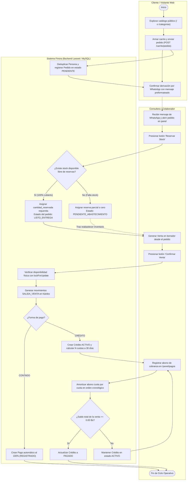
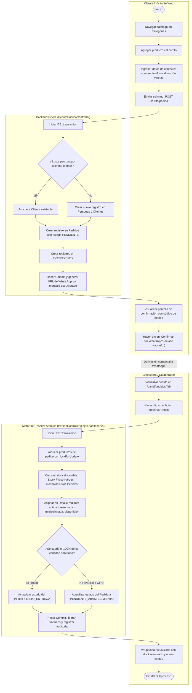
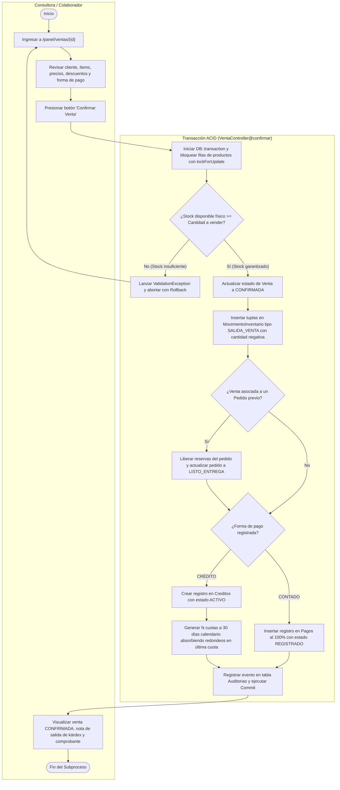
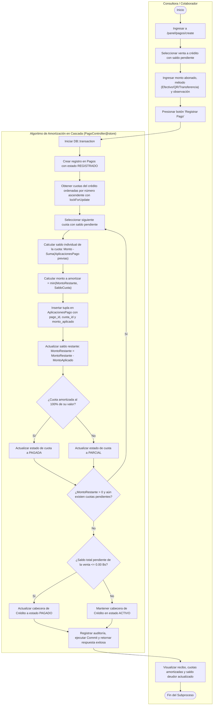
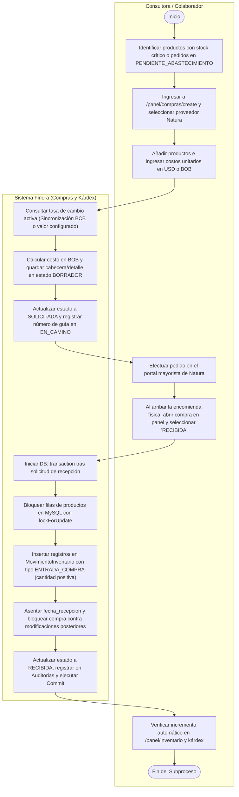

# Sistema Finora — Diagramas de Actividad UML

> **Materia:** INF412 – Sistemas de Información II  
> **Institución:** Universidad Autónoma Gabriel René Moreno (UAGRM) — Facultad Integral del Chaco (FICH)  
> **Proyecto:** Finora — Sistema de Información Web para la Gestión Comercial y Financiera de un Emprendimiento de Venta por Catálogo  
> **Docente:** Ing. Rolando Lijerón  
> **Estudiantes:** Josué Nicolás Chacae Veizaga, Maricelba Flores Aparicio, Malinda Nazareth Davila Mancilla, Midory Nayeli Toledo Moreno  
> **Fecha:** Octubre, 2026  

---

## Índice de Diagramas

1. [Diagrama 1: Macro-Proceso Comercial y Financiero (Visión Global de Negocio)](#diagrama-1-macro-proceso-comercial-y-financiero-visión-global)
2. [Diagrama 2: Captura de Pedidos Web y Reserva Atómica de Stock (CU-15 y CU-17)](#diagrama-2-captura-de-pedidos-web-y-reserva-atómica-de-stock-cu-15-y-cu-17)
3. [Diagrama 3: Confirmación Atómica de Venta, Salida de Kárdex y Crédito (CU-20 y CU-22)](#diagrama-3-confirmación-atómica-de-venta-salida-de-kárdex-y-crédito-cu-20-y-cu-22)
4. [Diagrama 4: Cobranza y Amortización en Cascada de Cuotas (CU-23)](#diagrama-4-cobranza-y-amortización-en-cascada-de-cuotas-cu-23)
5. [Diagrama 5: Abastecimiento, Conversión Multidivisa y Recepción en Kárdex (CU-08 y CU-09)](#diagrama-5-abastecimiento-conversión-multidivisa-y-recepción-en-kárdex-cu-08-y-cu-09)

---

## Diagrama 1: Macro-Proceso Comercial y Financiero (Visión Global)

### Contexto y Trazabilidad
Modela el ciclo operativo de extremo a extremo, integrando las 3 calles (*swimlanes*) de actores del sistema:
- **Cliente / Visitante Web**: Accede al catálogo público, arma el carrito y envía el pedido.
- **Consultora / Colaborador**: Gestiona las operaciones desde el panel de control.
- **Sistema Finora (Backend Laravel + Base de Datos MySQL)**: Orquesta validaciones, bloqueos pesimistas (`lockForUpdate`), kárdex y amortización de créditos.

### Código Fuente Mermaid

---

## Diagrama 2: Captura de Pedidos Web y Reserva Atómica de Stock (CU-15 y CU-17)

### Contexto y Trazabilidad
- **Controlador Web:** `app/Http/Controllers/PedidoPublicoController.php` (métodos `create` y `store`).
- **Controlador Operativo:** `app/Http/Controllers/Admin/PedidoController.php` (métodos `reservarStock` y `ejecutarReserva`).
- **Garantía Transaccional:** Se utiliza `DB::transaction` combinada con `lockForUpdate()` sobre la tabla de productos para evitar sobreventas concurrentes cuando dos clientes o administradores operan simultáneamente sobre la última unidad disponible.

### Código Fuente Mermaid

---

## Diagrama 3: Confirmación Atómica de Venta, Salida de Kárdex y Crédito (CU-20 y CU-22)

### Contexto y Trazabilidad
- **Controlador:** `app/Http/Controllers/Admin/VentaController.php` (método `confirmar`).
- **Modelos involucrados:** `Venta`, `DetalleVenta`, `MovimientoInventario`, `Credito`, `Cuota`, `Pago`.
- **Reglas del Negocio:**
  1. Valida que el stock físico descontando reservas de *otros* pedidos sea estrictamente suficiente.
  2. Genera registros inmutables en `movimientos_inventario` con `tipo = 'SALIDA_VENTA'` y cantidad negativa.
  3. Si la venta se derivó de un pedido, libera la reserva previa y lo marca en `LISTO_ENTREGA`.
  4. En ventas al contado, genera automáticamente el pago íntegro (`REGISTRADO`).
  5. En ventas a crédito, crea la cabecera en `creditos` y genera $N$ cuotas a 30 días, absorbiendo posibles residuos de decimales en la última cuota.

### Código Fuente Mermaid

---

## Diagrama 4: Cobranza y Amortización en Cascada de Cuotas (CU-23)

### Contexto y Trazabilidad
- **Controlador:** `app/Http/Controllers/Admin/PagoController.php` (método `store`).
- **Modelos involucrados:** `Pago`, `AplicacionPago`, `Cuota`, `Credito`, `Venta`.
- **Reglas del Negocio:**
  1. El cliente entrega un importe (sea en efectivo, transferencia o QR).
  2. El sistema recupera las cuotas del crédito ordenadas por `numero ASC` y las bloquea con `lockForUpdate()`.
  3. Aplica el monto disponible cuota por cuota: las que se cubran por completo pasan a `PAGADA`; si el abono se agota a medio camino, esa cuota queda en `PARCIAL`.
  4. Crea tuplas de trazabilidad en `aplicaciones_pago` con el monto exacto asignado a cada cuota.
  5. Si el saldo restante de la venta llega a `0.00 Bs`, el crédito pasa de forma automática a estado `PAGADO`.

### Código Fuente Mermaid

---

## Diagrama 5: Abastecimiento, Conversión Multidivisa y Recepción en Kárdex (CU-08 y CU-09)

### Contexto y Trazabilidad
- **Controladores:** `app/Http/Controllers/Admin/CompraController.php` y `app/Http/Controllers/TipoCambioController.php`.
- **Modelos involucrados:** `Compra`, `DetalleCompra`, `Configuracion`, `MovimientoInventario`, `Producto`.
- **Reglas del Negocio:**
  1. Permite cotizar compras en moneda extranjera (USD) convirtiendo automáticamente a Bolivianos (BOB) según el tipo de cambio oficial sincronizado con el BCB o valor de contingencia.
  2. Ciclo de estados de la orden: `BORRADOR -> SOLICITADA -> EN_CAMINO -> RECIBIDA`.
  3. Al marcarse como `RECIBIDA`, una transacción atómica genera movimientos en `movimientos_inventario` con `tipo = 'ENTRADA_COMPRA'` con cantidad positiva, actualizando el stock disponible de forma instantánea y bloqueando la compra contra futuras modificaciones.

### Código Fuente Mermaid

---

## Recomendaciones para la Inserción en el Documento Oficial

Para cumplir con el formato **APA 7** adoptado en el documento oficial `Finora_Documento_Original_Tablas_APA7.pdf`:

1. **Ubicación recomendada:**
   - **Capítulo II (Sección 2.3):** Reemplazar o acompañar las listas de texto de las páginas 21 a 23 con las figuras:
     - *Figura 2.1: Diagrama de Actividad — Proceso de Abastecimiento y Compra a Proveedor.*
     - *Figura 2.2: Diagrama de Actividad — Captura de Pedidos Web y Reserva Atómica de Stock.*
     - *Figura 2.3: Diagrama de Actividad — Venta, Financiamiento a Crédito y Cobranza en Cascada.*
   - **O Capítulo V (Sección 5.4):** Como nueva subsección titulada *“Diagramas de Actividad UML de los Flujos Críticos”*, justo después de los diagramas de secuencia.
2. **Formato de Figura según APA 7:**
   - **Número de figura** en negrita (ej. **Figura 2.2**).
   - **Título en cursiva** una línea abajo (ej. *Diagrama de Actividad del Proceso de Captura de Pedidos y Reserva Atómica*).
   - Imagen del diagrama centrada.
   - **Nota al pie:** *Nota.* Diagrama de actividad UML modelado con calles de responsabilidad (swimlanes) y trazabilidad directa sobre el backend Laravel y motor InnoDB de MySQL.
