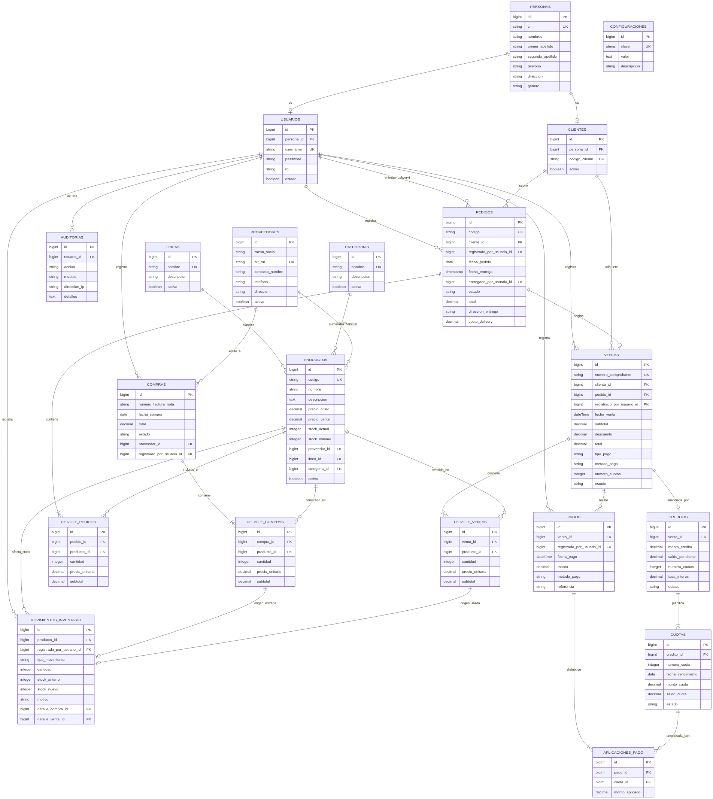
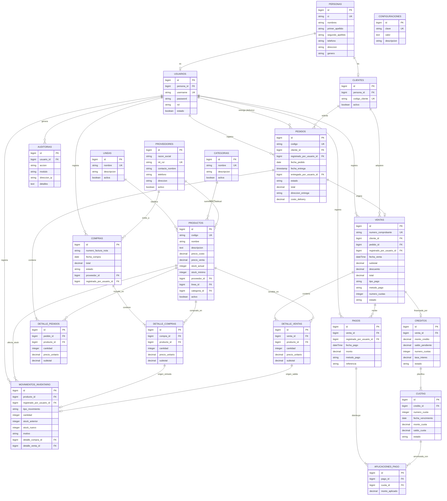
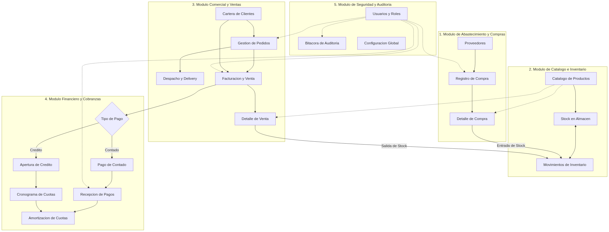
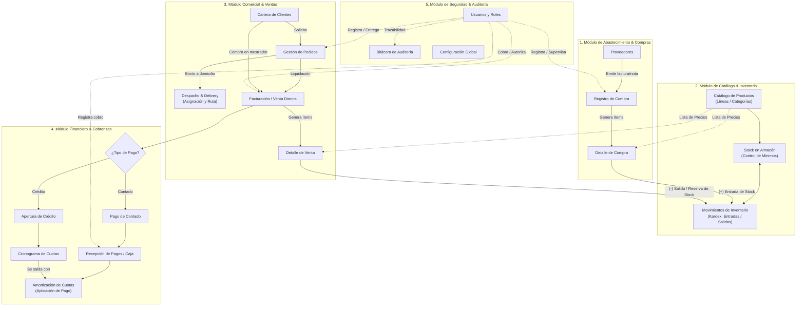

# Diagramas del Sistema ERP - Finora

Este documento contiene los dos diagramas del sistema **Finora**, construidos a partir de los modelos y migraciones reales de la base de datos:

1. **Diagrama Entidad-Relación (ERD / DER):** Estructura relacional de datos física (tablas, campos clave y cardinalidades).
2. **Diagrama de Arquitectura y Procesos ERP:** Mapa funcional por módulos y flujo operativo del negocio.

---

## 1. Diagrama Entidad-Relación (ERD / DER)

> **Archivos de imagen listos para descargar o insertar en documentos:**
> - Imagen PNG de alta resolución: [`docs/diagrama_erd_finora.png`](file:///d:/Proyectos/finora/docs/diagrama_erd_finora.png)
> - Gráfico vectorial SVG: [`docs/diagrama_erd_finora.svg`](file:///d:/Proyectos/finora/docs/diagrama_erd_finora.svg)



### 1.1 Código Fuente Mermaid



### 1.2 Código DBML (para importar en [dbdiagram.io](https://dbdiagram.io))

```dbml
Table personas {
  id bigint [pk, increment]
  ci varchar [unique]
  nombres varchar
  primer_apellido varchar
  segundo_apellido varchar
  telefono varchar
  direccion varchar
  genero varchar
  created_at timestamp
  updated_at timestamp
}

Table usuarios {
  id bigint [pk, increment]
  persona_id bigint [unique, ref: - personas.id]
  username varchar [unique]
  password varchar
  rol varchar
  estado boolean
  created_at timestamp
  updated_at timestamp
}

Table clientes {
  id bigint [pk, increment]
  persona_id bigint [unique, ref: - personas.id]
  codigo_cliente varchar [unique]
  activo boolean
  created_at timestamp
  updated_at timestamp
}

Table proveedores {
  id bigint [pk, increment]
  razon_social varchar
  nit_rut varchar [unique]
  contacto_nombre varchar
  telefono varchar
  direccion varchar
  activo boolean
  created_at timestamp
  updated_at timestamp
}

Table lineas {
  id bigint [pk, increment]
  nombre varchar [unique]
  descripcion varchar
  activa boolean
  created_at timestamp
  updated_at timestamp
}

Table categorias {
  id bigint [pk, increment]
  nombre varchar [unique]
  descripcion varchar
  activa boolean
  created_at timestamp
  updated_at timestamp
}

Table productos {
  id bigint [pk, increment]
  codigo varchar [unique]
  nombre varchar
  descripcion text
  precio_costo decimal
  precio_venta decimal
  stock_actual int
  stock_minimo int
  proveedor_id bigint [ref: > proveedores.id]
  linea_id bigint [null, ref: > lineas.id]
  categoria_id bigint [ref: > categorias.id]
  activo boolean
  created_at timestamp
  updated_at timestamp
}

Table compras {
  id bigint [pk, increment]
  numero_factura_nota varchar
  fecha_compra date
  total decimal
  estado varchar
  proveedor_id bigint [ref: > proveedores.id]
  registrado_por_usuario_id bigint [null, ref: > usuarios.id]
  created_at timestamp
  updated_at timestamp
}

Table detalle_compras {
  id bigint [pk, increment]
  compra_id bigint [ref: > compras.id]
  producto_id bigint [ref: > productos.id]
  cantidad int
  precio_unitario decimal
  subtotal decimal
}

Table pedidos {
  id bigint [pk, increment]
  codigo varchar [unique]
  cliente_id bigint [ref: > clientes.id]
  registrado_por_usuario_id bigint [null, ref: > usuarios.id]
  fecha_pedido date
  fecha_entrega timestamp
  entregado_por_usuario_id bigint [null, ref: > usuarios.id]
  estado varchar
  total decimal
  direccion_entrega varchar
  costo_delivery decimal
  created_at timestamp
  updated_at timestamp
}

Table detalle_pedidos {
  id bigint [pk, increment]
  pedido_id bigint [ref: > pedidos.id]
  producto_id bigint [ref: > productos.id]
  cantidad int
  precio_unitario decimal
  subtotal decimal
}

Table ventas {
  id bigint [pk, increment]
  numero_comprobante varchar [unique]
  cliente_id bigint [ref: > clientes.id]
  pedido_id bigint [null, ref: - pedidos.id]
  registrado_por_usuario_id bigint [null, ref: > usuarios.id]
  fecha_venta datetime
  subtotal decimal
  descuento decimal
  total decimal
  tipo_pago varchar
  metodo_pago varchar
  numero_cuotas int
  estado varchar
  created_at timestamp
  updated_at timestamp
}

Table detalle_ventas {
  id bigint [pk, increment]
  venta_id bigint [ref: > ventas.id]
  producto_id bigint [ref: > productos.id]
  cantidad int
  precio_unitario decimal
  subtotal decimal
}

Table creditos {
  id bigint [pk, increment]
  venta_id bigint [unique, ref: - ventas.id]
  monto_credito decimal
  saldo_pendiente decimal
  numero_cuotas int
  tasa_interes decimal
  estado varchar
  created_at timestamp
  updated_at timestamp
}

Table cuotas {
  id bigint [pk, increment]
  credito_id bigint [ref: > creditos.id]
  numero_cuota int
  fecha_vencimiento date
  monto_cuota decimal
  saldo_cuota decimal
  estado varchar
  created_at timestamp
  updated_at timestamp
}

Table pagos {
  id bigint [pk, increment]
  venta_id bigint [ref: > ventas.id]
  registrado_por_usuario_id bigint [null, ref: > usuarios.id]
  fecha_pago datetime
  monto decimal
  metodo_pago varchar
  referencia varchar
  created_at timestamp
  updated_at timestamp
}

Table aplicaciones_pago {
  id bigint [pk, increment]
  pago_id bigint [ref: > pagos.id]
  cuota_id bigint [ref: > cuotas.id]
  monto_aplicado decimal
  created_at timestamp
  updated_at timestamp
}

Table movimientos_inventario {
  id bigint [pk, increment]
  producto_id bigint [ref: > productos.id]
  registrado_por_usuario_id bigint [null, ref: > usuarios.id]
  tipo_movimiento varchar
  cantidad int
  stock_anterior int
  stock_nuevo int
  motivo varchar
  detalle_compra_id bigint [null, ref: > detalle_compras.id]
  detalle_venta_id bigint [null, ref: > detalle_ventas.id]
  created_at timestamp
  updated_at timestamp
}

Table auditorias {
  id bigint [pk, increment]
  usuario_id bigint [null, ref: > usuarios.id]
  accion varchar
  modulo varchar
  direccion_ip varchar
  detalles text
  created_at timestamp
}

Table configuraciones {
  id bigint [pk, increment]
  clave varchar [unique]
  valor text
  descripcion varchar
  created_at timestamp
  updated_at timestamp
}
```

---

## 2. Diagrama de Módulos y Procesos ERP (Flujo Operativo)

> **Archivos de imagen listos para descargar o insertar en documentos:**
> - Imagen PNG de alta resolución: [`docs/diagrama_procesos_erp_finora.png`](file:///d:/Proyectos/finora/docs/diagrama_procesos_erp_finora.png)
> - Gráfico vectorial SVG: [`docs/diagrama_procesos_erp_finora.svg`](file:///d:/Proyectos/finora/docs/diagrama_procesos_erp_finora.svg)



### 2.1 Código Fuente Mermaid



### Resumen de los Flujos de Negocio del ERP

1. **Flujo de Abastecimiento:**
   Se registran compras asociadas a proveedores. Cada ítem de compra impacta directamente en el módulo de inventario registrando una **entrada física** en el Kardex y actualizando el stock actual y costo promedio.
2. **Flujo de Pedido a Facturación (Order-to-Cash):**
   Un cliente puede realizar un pedido (con opción de delivery y seguimiento de entrega por repartidor/usuario) o compra directa. Al concretarse la venta, se genera la salida del stock en el inventario.
3. **Flujo Financiero (Cuentas por Cobrar):**
   Las ventas pueden ser al contado o al crédito. Si es al crédito, se genera una tabla de amortización con cuotas y fechas de vencimiento. Los pagos posteriores recibidos en caja se distribuyen selectivamente a las cuotas mediante aplicaciones de pago hasta liquidar el saldo.
4. **Flujo Transversal de Control:**
   Todas las operaciones registran el usuario responsable y los eventos críticos alimentan el módulo de auditoría del sistema.

